<a href="https://miguel-garcia-bilbao.vercel.app/en">
  <picture>
    <source media="(max-width: 600px)" srcset="assets/hero-mobile.svg">
    
  </picture>
</a>

Illustrative figure: my career drawn the way my MSc thesis draws glucose forecasts, an observed trace followed by a probabilistic forecast.

**I build AI systems and the products around them.** Five years shipping Angular, .NET and Java applications to production, and now the retrieval pipelines and forecasting models behind them too. I work on nettrim's Data Intelligence Hub and hold an MSc in Artificial Intelligence from UAX (2026).

Open to applied AI and senior frontend roles. Based in Burgos, Spain, working remotely.

**[Portfolio](https://miguel-garcia-bilbao.vercel.app/en)** &nbsp;·&nbsp; [CV (PDF)](https://miguel-garcia-bilbao.vercel.app/cv/miguel-garcia-bilbao-en.pdf) &nbsp;·&nbsp; [LinkedIn](https://www.linkedin.com/in/miguelgarciabilbao) &nbsp;·&nbsp; [miguel99bilbao@gmail.com](mailto:miguel99bilbao@gmail.com)

## Selected work

**[RAG pipeline for ESG consulting](https://miguel-garcia-bilbao.vercel.app/en/projects/rag-esg)** &nbsp;·&nbsp; nettrim technology, 2026 
The retrieval pipeline behind an ESG consulting platform: document corpus, embeddings, vector layer and LLM answers on Amazon Bedrock. The corpus is enriched with OSINT, and every generated report feeds back into it. Built in Python with Hugging Face models.

**[Glucose and hypoglycaemia forecasting in type 1 diabetes](https://miguel-garcia-bilbao.vercel.app/en/projects/tfm-hipoglucemia)** &nbsp;·&nbsp; MSc thesis, UAX, 2026 
A global probabilistic model that predicts continuous glucose readings 30 and 60 minutes ahead on the OhioT1DM dataset, with a mean and a variance per horizon, and raises an early alarm when P(glucose &lt; 70 mg/dL) crosses a threshold. Validated externally on HUPA-UCM. Built in Python and PyTorch.

**Jarvis** &nbsp;·&nbsp; personal project, private repository 
A desktop companion backed by a fully local agent: a local language model, no cloud AI account, and long-term memory kept in an Obsidian vault. Built with Electron and TypeScript.

**MetroDirect** &nbsp;·&nbsp; personal project, private repository 
A mobile-first PWA for the Valencia metro network: live train positions, a search that works out transfers, and its own design system. Built in TypeScript.

**[Portfolio](https://github.com/MiguelGarciaBilbao/portfolio)** &nbsp;·&nbsp; public repository 
The site linked above. My experience indexed as a WebGL point cloud you can query, with static SVG fallbacks for every 3D scene. Built with Next.js 16 and React Three Fiber.

## Stack

<table>
  <tr>
    <td><b>Applied&nbsp;AI</b></td>
    <td>Python, RAG, embeddings, vector search, Amazon Bedrock, Hugging Face, PyTorch, time-series forecasting</td>
  </tr>
  <tr>
    <td><b>Frontend</b></td>
    <td>Angular (2 to v20), TypeScript, Signals, RxJS, NgRx, Signal Stores, Web Components, SSR</td>
  </tr>
  <tr>
    <td><b>Backend&nbsp;and&nbsp;cloud</b></td>
    <td>.NET / C#, Java (Spring), Node.js, PostgreSQL, SQL Server, AWS (Bedrock, S3, ECS), Azure, Docker, CI/CD</td>
  </tr>
</table>

## Background

<table>
  <tr>
    <td><code>2026</code></td>
    <td><b>MSc in Artificial Intelligence</b>, Universidad Alfonso X el Sabio (UAX)</td>
  </tr>
  <tr>
    <td><code>2026–&#8288;now</code></td>
    <td><b>Senior Frontend Engineer</b>, nettrim technology. Data Intelligence Hub: applied AI for ESG data, frontend architecture in Angular.</td>
  </tr>
  <tr>
    <td><code>2021–&#8288;2026</code></td>
    <td><b>Software Engineer and Technical Lead</b>, Softeca. Led a team of 5 and the migration of an 8-module legacy system to .NET and Angular, cutting incidents and turnaround times by 30%.</td>
  </tr>
  <tr>
    <td><code>2017–&#8288;2021</code></td>
    <td><b>BSc in Computer Engineering</b>, Universidad de Burgos (UBU)</td>
  </tr>
</table>

Email is the fastest way to reach me: [miguel99bilbao@gmail.com](mailto:miguel99bilbao@gmail.com)
